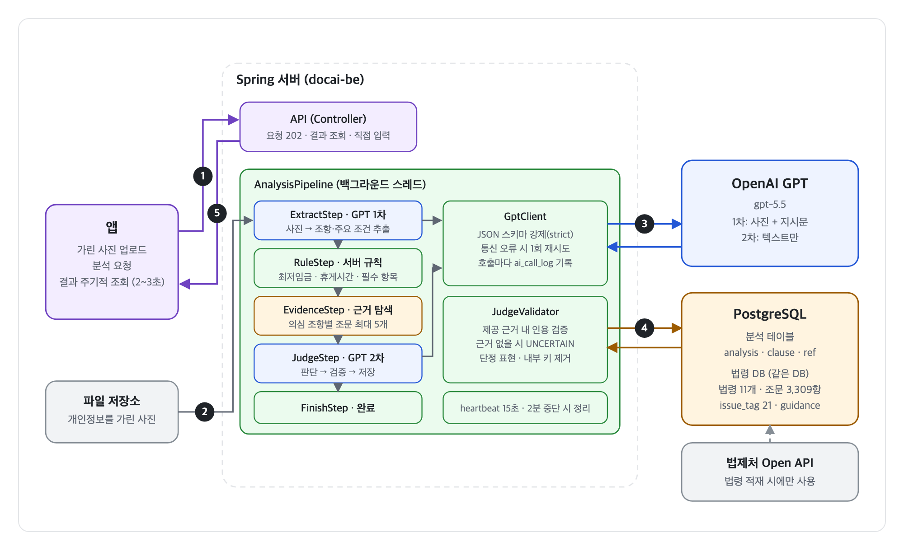
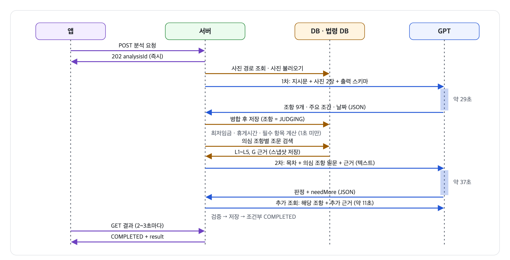
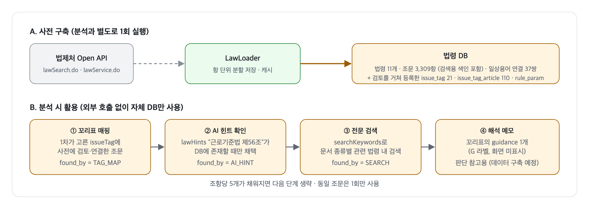

# 문서AI 백엔드

사회초년생이 계약서 사진을 올리면, 불리하거나 법령에 어긋날 소지가 있는 조항을 **법령 근거와 함께** 찾아 주고 일정 관리까지 이어 주는 서비스의 백엔드입니다.

- Java 17 · Spring Boot 3.5 · PostgreSQL · Flyway
- OpenAI GPT-5.5 (Strict JSON 스키마)
- 법제처 Open API로 구축한 법령 DB (11개 법령 · 3,309개 조문 행)

이전 작업 기록은 [README_old.md](README_old.md)에 있습니다.

---

## AI 분석 파이프라인

GPT가 모든 것을 판단하지 않도록 **GPT · 서버 코드 · 법령 DB의 역할을 나눴습니다.** GPT는 읽기와 설명을, 서버 코드는 계산과 검증을, 법령 DB는 근거를 맡습니다.

### 구성도



| 번호 | 데이터 흐름 |
|---|---|
| 1 | 앱 → 서버: 분석 요청. 서버는 분석 기록을 만들고 즉시 202와 analysisId를 반환 |
| 2 | 저장소 → 서버: 개인정보를 가린 사진을 불러옴 |
| 3 | 서버 ↔ GPT: 1차(사진 포함), 2차(텍스트만). 모든 응답은 Strict JSON 스키마로 수신 |
| 4 | 서버 ↔ DB: 단계별 결과 저장, 근거 찾기 때 법령 테이블 검색 (외부 API 호출 없음) |
| 5 | 서버 → 앱: 진행 중에는 진행 단계를, 완료 후에는 전체 결과를 반환 |

### 처리 순서 (실제 연봉계약서 1건, 약 80초)



### 단계별 역할

| 단계 | 담당 | 하는 일 |
|---|---|---|
| ① 1차 판독 (EXTRACT) | GPT | 사진에서 조항 원문, 임금·근로시간 같은 주요 조건, 날짜를 적힌 그대로 추출합니다. 최종 판단은 하지 않고 의심 조항에 표시만 합니다. 5쪽 단위로 나눠 병렬 처리합니다. |
| ② 서버 규칙 계산 | 서버 코드 | 최저임금(시급 환산), 휴게시간(근로기준법 제54조), 필수 기재사항(근로기준법 제17조)을 코드로 직접 계산합니다. 이 결과는 2차 GPT가 바꿀 수 없습니다. |
| ③ 근거 찾기 | 법령 DB | 분석 중에는 외부 API를 부르지 않습니다. 의심 조항마다 자주 나오는 문제 유형(꼬리표 21개)에 연결된 조문 → GPT가 제시한 조문 중 DB에 실제로 있는 조문 → 키워드 전문 검색 순으로 최대 5개를 찾습니다. "월세→차임", "알바→단시간근로"처럼 일상어를 법률 용어로 바꿔 검색합니다. |
| ④ 2차 판단 (JUDGE) | GPT | 사진 없이 목차, 의심 조항 원문, 찾은 조문 원문만 받아 판단합니다. "서명 당사자에게 실제로 불리한 내용을 정했는가"를 기준으로 같은 조항에는 같은 판단을 내립니다. 근거가 부족하면 한 번 더 찾아 다시 판단합니다. |
| ⑤ 검증 | 서버 코드 | 제공하지 않은 조문 인용, "무효"·"불법" 같은 단정 표현, 내부 키를 지웁니다. 법령 조문 근거가 없는 판단은 "판단 어려움"으로 낮추고 법령을 표시하지 않습니다. |

### 판정 값

| 값 | 화면 | 의미 |
|---|---|---|
| NEEDS_CHECK | 확인 필요 | 법령 조문 근거가 확인된 문제 조항 |
| UNCERTAIN | 판단 어려움 | 불리할 수 있으나 근거 조문을 확인하지 못한 조항 |
| OK | 문제없음 | 불리한 내용이 없거나 근거로 보아 법에 맞는 조항 |

### 정확성을 위한 설계

1. **역할 분리**: 1차 GPT는 읽기만, 2차 GPT는 판단만 합니다.
2. **계산은 코드로**: 숫자 판단은 서버 규칙이 하고, GPT가 결과를 바꿀 수 없습니다.
3. **근거 없는 판단은 보수적으로**: 2차 GPT는 서버가 준 조문만 인용할 수 있습니다. GPT가 그럴듯한 조문을 지어내도 DB에 없으면 쓰지 않습니다.
4. **정해진 형식으로만 통신**: GPT 응답은 Strict JSON 스키마로 받고, 서버가 다시 검사한 뒤 저장합니다.
5. **일관된 판단 기준**: 법령 준용 조항이나 관할법원 조항처럼 그 자체로 불리하지 않은 조항에는 경고를 붙이지 않아, 같은 계약서를 반복 분석해도 결과가 흔들리지 않게 했습니다.

### 단계별 데이터 형식 (JSON)

각 단계에서 실제로 주고받는 데이터입니다. 예시의 개인 정보(금액·날짜)는 ○로 가렸습니다. 토글 버튼을 클릭해 내용을 확인하실 수 있습니다.

<details>
<summary><b>① 앱 → 서버: 분석 요청 (202 즉시 응답)</b></summary>

POST /api/contracts/{contractId}/analyses. 요청 본문과 사진은 없고, 서버가 저장된 사진을 직접 불러옵니다.

```json
{ "status": 202,
  "data": { "analysisId": 88, "contractId": 12, "status": "ANALYZING",
            "progressStep": "READING_TEXT", "readProgress": { "done": 0, "total": 1 } } }
```

</details>
<details>
<summary><b>② 서버 → 1차 GPT: 사진 판독 요청</b></summary>

사진은 base64로 넣고, 응답 형식은 Strict JSON 스키마로 강제합니다. 매번 같은 지시문은 앞에 두어 프롬프트 캐시를 적용합니다.

```jsonc
{
  "model": "gpt-5.5",
  "messages": [
    { "role": "system", "content": "모든 조항을 그대로 옮겨 적고, 문제가 있어 보이는 조항에만 의심 표시와 검색어를 붙인다.
                                    최종 판단은 하지 않는다. 직접 쓰는 글에는 c1 같은 키를 쓰지 않는다. ...
                                    꼬리표 목록: PENALTY_ON_RESIGNATION, MIN_WAGE_SHORTFALL, ... (21개)" },
    { "role": "user", "content": [
        { "type": "text", "text": "고른 문서 종류: 근로계약서(EMPLOYMENT). 1~2쪽" },
        { "type": "image_url", "image_url": { "url": "data:image/jpeg;base64,...", "detail": "high" } },
        { "type": "image_url", "image_url": { "url": "data:image/jpeg;base64,...", "detail": "high" } } ] }
  ],
  "response_format": { "type": "json_schema",
                       "json_schema": { "name": "extract", "strict": true, "schema": { ... } } },
  "reasoning_effort": "low",
  "max_completion_tokens": 32000
}
```

</details>
<details>
<summary><b>③ 1차 GPT → 서버: 판독 결과</b></summary>

화면용 글(value)과 계산용 숫자(valueJson)를 따로 받습니다. 서버 계산에는 valueJson만 씁니다. issueFound는 의심 표시일 뿐 최종 판단이 아닙니다.

```jsonc
{
  "documentTitle": "연봉계약서",
  "contractDate": "20○○-○○-○○",
  "typeCheck": { "matchesSelected": true, "detectedTypeName": null },
  "wageOnlyDocument": true,                       // 임금만 정한 문서인지
  "pages": [ { "pageNo": 1, "readState": "READ" }, { "pageNo": 2, "readState": "READ" } ],
  "clauses": [ {
      "clauseKey": "c1", "pageNo": 1, "articleNo": "제1조", "title": "임금",
      "originalText": "월 기본급 ... 약정연장근로수당 ○○○,○○○원 ...",
      "oneLine": "월급 구성과 금액",
      "location": "1쪽 위쪽 표",
      "continuesFromPreviousPage": false, "continuesToNextPage": false,
      "issueFound": true,                             // 의심일 뿐 최종 판단 아님
      "issueSummary": "연장근로수당을 월급에 미리 넣어 둠",
      "issueTag": "INCLUSIVE_WAGE",                   // 꼬리표 (없으면 null)
      "lawHints": [ { "law": "근로기준법", "article": "제56조" } ],
      "searchKeywords": [ "연장근로", "가산임금" ],
      "relatedClauseKeys": [ "c4" ] } ],
  "keyTerms": [ {
      "label": "임금", "state": "OK", "value": "월 ○,○○○,○○○원 (기본급·식대·약정연장수당)",
      "valueJson": { "type": "MONTHLY", "amount": ○○○○○○○, "basePay": ○○○○○○○,
                     "hoursPerDay": null, "daysPerWeek": null, "monthlyHours": 209,
                     "start": null, "end": null },     // 서버 계산용 숫자
      "clauseKey": "c1", "evidence": "1쪽 제1조" } ],
  "dates": [ { "label": "계약 시작일", "date": "20○○-○○-○○", "clauseKey": "c2" } ]
}
```

</details>
<details>
<summary><b>④ 법령 DB 근거 찾기 결과 (analysis_clause_ref 저장)</b></summary>

의심 조항마다 찾은 조문을 L1, L2 … 라벨과 함께 저장합니다. ref_text는 분석 시점의 조문 원문 사본입니다.

```text
clause c1 의 근거
 L1  근로기준법 제56조 제1항 (연장·야간 및 휴일 근로)  found_by=TAG_MAP   ref_text="사용자는 연장근로에 대하여는 ..."
 L2  근로기준법 제53조 제1항 (연장 근로의 제한)        found_by=TAG_MAP   ref_text="당사자 간에 합의하면 1주 간에 12시간을 ..."
 L3  근로기준법 제56조 제2항                          found_by=AI_HINT   ...
cited = false (2차가 인용하고 검증을 통과하면 true)
```

</details>
<details>
<summary><b>⑤ 서버 → 2차 GPT: 판단 요청 (텍스트만)</b></summary>

DB에 저장된 값으로 구성합니다. [L1] 아래 문장은 GPT가 만든 글이 아니라 법령 DB의 실제 조문 원문이며, """원문"""은 계약서 문장을 지시로 오인하지 않도록 구분하는 표시입니다.

```text
[전체 목차] clauseKey | 조 번호 | 제목 | 한 줄 요약
- c1 | 제1조 | 임금 | 월급 구성과 금액
- c2 | 제2조 | 계약기간 | 20○○.○.○ ~ 20○○.○.○○
- c4 | 제4조 | 법정수당 지급 및 결근공제 | 일부 직원 법정수당 미지급
...
[규칙 결과: 빠진 필수 항목] (코드가 계산함. 판단과 어긋나게 쓰지 않는다)
- 근로계약서와 함께 확인: 휴일·연차휴가·근무장소·업무

[판단할 조항]
### c1 (제1조 임금, 1쪽)
1차 의심 내용: 연장근로수당을 월급에 미리 넣어 둠
원문:
"""월 기본급 ... 약정연장근로수당 ○○○,○○○원 ..."""
근거 (이 조항에서 인용할 수 있는 ID):
[L1] 근로기준법 제56조 (연장·야간 및 휴일 근로)
사용자는 연장근로에 대하여는 통상임금의 100분의 50 이상을 가산하여 ...
[L2] 근로기준법 제53조 (연장 근로의 제한) ...
관련 조항 원문:
- c4 (제4조 법정수당 지급 및 결근공제): """..."""
```

</details>
<details>
<summary><b>⑥ 2차 GPT → 서버: 판단 결과</b></summary>

citedIds는 서버가 준 라벨만 허용합니다. 근거가 부족하면 needMore로 추가 검색을 요청하고, 서버가 한 번 더 찾아 다시 판단합니다.

```jsonc
{
  "judgments": [ {
      "clauseKey": "c1",
      "verdict": "NEEDS_CHECK",                         // NEEDS_CHECK / UNCERTAIN / OK
      "headline": "월급에 약정연장근로수당 ○○○,○○○원이 들어간 것으로 보이는 임금 조항",
      "easyExplanation": "월급 안에 연장근로수당이 미리 들어 있다는 뜻이에요 ...",
      "whyCheck": "연장·야간·휴일근로에는 가산임금을 지급하는 기준이 있고 ...",
      "citedIds": [ "L1", "L2" ],                       // 서버가 준 라벨만 허용
      "relatedClauses": [ "c4" ],
      "askCounterpart": [ "이 금액은 몇 시간분 연장근로를 전제로 한 건가요?" ] } ],
  "needMore": [ { "clauseKey": "c9", "want": "관할 합의 관련 조문",
                  "searchKeywords": [ "관할", "소송" ] } ],   // 근거가 부족하면
  "questionsBeforeSigning": [ "제1조의 약정연장근로수당 금액과 산정 근거를 확인해 주실 수 있을까요?" ]
}
```

</details>
<details>
<summary><b>⑦ 서버 → 앱: 결과 조회</b></summary>

GET /api/analyses/{analysisId}. 검증을 거쳐 저장된 값만 읽으며, 조회할 때 GPT를 다시 부르지 않습니다. UNCERTAIN 조항은 description을 null, laws를 빈 배열로 보냅니다.

```json
{ "status": "COMPLETED", "progressStep": "DONE",
  "result": {
    "title": "연봉계약서",
    "keyTerms": [
      { "label": "계약기간", "value": "20○○ 년 ○○ 월 ○○ 일 ~ 20○○ 년 ○○ 월 ○○ 일", "state": "OK", "source": "WRITTEN" },
      { "label": "근무장소", "value": null, "state": "MISSING", "source": null } ],
    "counts": { "needsCheck": 6, "missing": 1, "deadline": 0, "totalClauses": 9 },
    "priorityClauses": [ {
        "clauseId": 3586, "verdict": "NEEDS_CHECK",
        "title": "월급에 약정연장근로수당 ○○○,○○○원이 들어간 것으로 보이는 임금 조항",
        "description": "연장·야간·휴일근로에 대해서는 가산임금을 지급하는 기준이 제시되어 있고 ...",
        "comparison": null,
        "laws": [ { "lawName": "근로기준법", "article": "제56조" }, { "lawName": "근로기준법", "article": "제53조" } ],
        "basisType": "AI_INTERPRETATION",
        "relatedClauses": [ { "clauseId": 3589, "articleNo": "제4조", "title": "법정수당 지급 및 결근공제" } ] } ],
    "questionsBeforeSigning": [ "제1조의 약정연장근로수당 금액과 ‘해당사항 없음’ 문구가 서로 달라 보이는데 ..." ] } }
```

</details>

### 검증 결과

문제 조항을 일부러 넣은 가상 계약서 테스트 케이스 18건(근로·임대차)에서:

- 문제 조항 탐지 23/23, 근거 법령 일치 23/23
- 문제없는 조항을 잘못 표시한 경우(오탐) 0건
- 단정 표현 · 내부 키 노출 0건

실물 계약서 1건 분석은 약 80초 걸립니다.

---

## 법령 DB



| 항목 | 내용 |
|---|---|
| 법령 | 근로기준법, 최저임금법, 근로자퇴직급여 보장법, 주택임대차보호법, 민법, 민간임대주택에 관한 특별법과 각 시행령 (11개) |
| 조문 | 3,309행 (조·항 단위, PostgreSQL 전문 검색 색인) |
| 꼬리표 | 자주 나오는 문제 유형 21개와 근거 조문 연결 |
| 일상용어 | 법제처 일상용어-법령용어 연계 데이터 기반 37쌍 |

법령은 분석 중에 받아 오지 않고, 적재 모드로 한 번 실행해 DB에 저장합니다.

```bash
./gradlew bootRun --args='--docai.law.load=true --server.port=0'
```

법제처 API 키(LAW_API_KEY)가 필요하며, 키에 등록된 IP에서만 동작합니다. 찾은 조문은 분석 시점의 원문을 복사해 저장하므로, 이후 법령이 개정되어도 기존 분석의 근거는 바뀌지 않습니다.

---

## 실행

```bash
./gradlew build      # 빌드
./gradlew test       # 테스트
./gradlew bootRun    # 서버 실행 (OPENAI_API_KEY, DB 접속 정보 필요)
```

## 패키지 구조

```
web/{기능}/       Controller, Request/Response
domain/{기능}/    Command/Info, Entity, Repository, Service, Client
global/           공통 응답, 설정, 오류 처리
```

- 분석·챗봇·법령: `domain/analysis`, `domain/chat`, `domain/law`
- 서비스(사용자·인증·문서 종류·계약서·비교·일정·알림): `domain/user`, `domain/auth`, `domain/documenttype`, `domain/contract`, `domain/comparison`, `domain/schedule`, `domain/notification`
